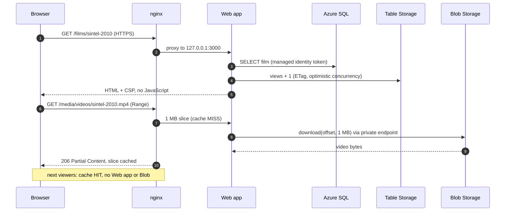
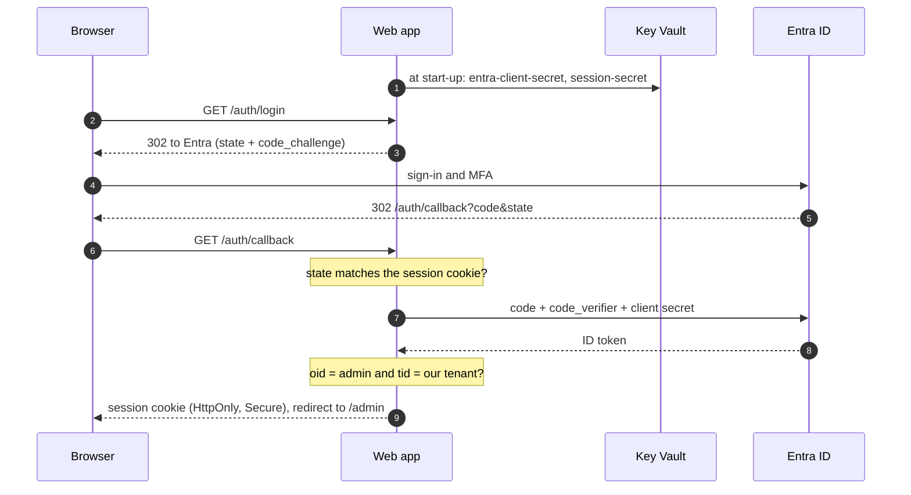
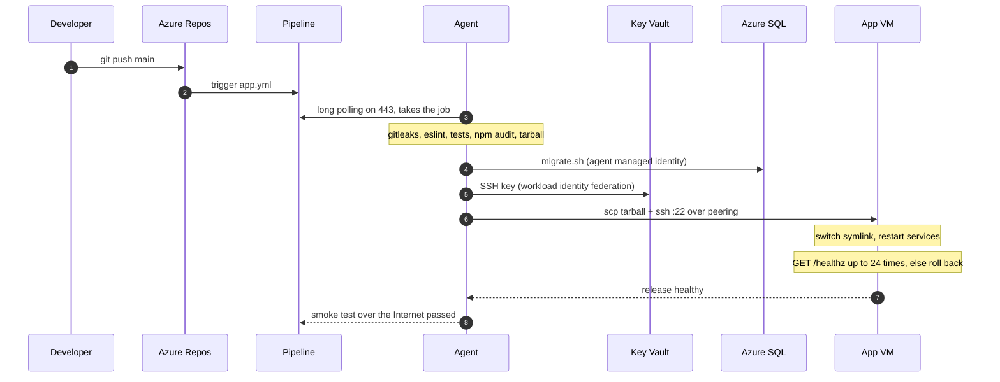

# Sequence diagrams

How the components talk to each other in the four main scenarios. The
diagrams are Mermaid: Azure DevOps wikis, GitHub and VS Code render them.

## Watching a film

The page and the video are two separate requests. nginx caches video in
1 MB slices, so only the first viewer of a slice reaches Blob Storage.



## Admin sign-in

OpenID Connect authorization code flow with PKCE. No tokens are stored; the
signed session cookie holds only the name and object ID.



## Importing a film

The web app only queues the job; the worker does the slow part.

```mermaid
sequenceDiagram
    autonumber
    participant A as Admin
    participant W as Web app
    participant S as Azure SQL
    participant Q as Queue
    participant K as Worker
    participant TM as TMDB
    participant AR as archive.org
    participant BL as Blob Storage

    A->>W: POST /admin/import-starter
    W->>S: INSERT film (status queued)
    W->>Q: sendMessage {filmId}
    K->>Q: receive (invisible for 1 hour)
    K->>TM: search + details + trailer
    K->>BL: poster JPEG + WebP thumbnail
    K->>AR: GET mp4 (https, allow-listed hosts only)
    K->>BL: uploadStream in 8 MB blocks
    K->>S: status = ready
    K->>Q: deleteMessage
    Note over K: on error: retry; after 5 attempts status = failed
```

## Deploying the app

From `git push` to a new release, with automatic rollback.


